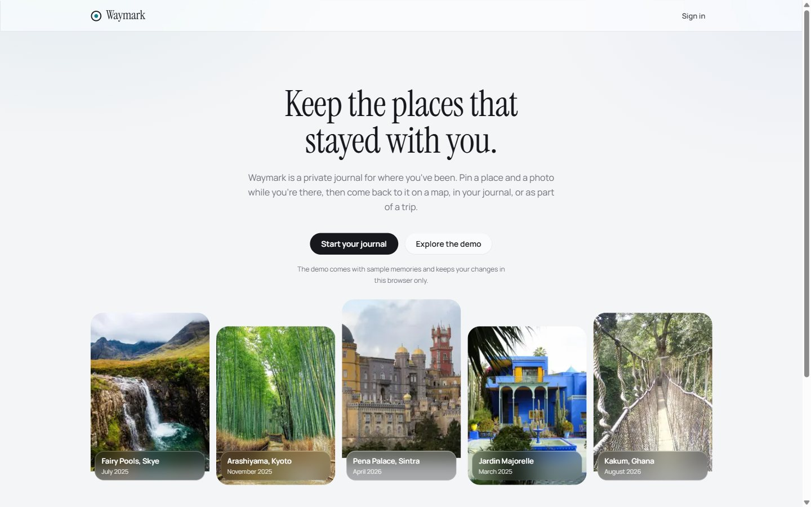
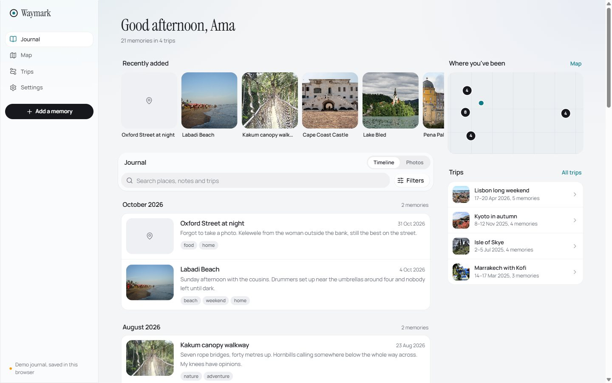
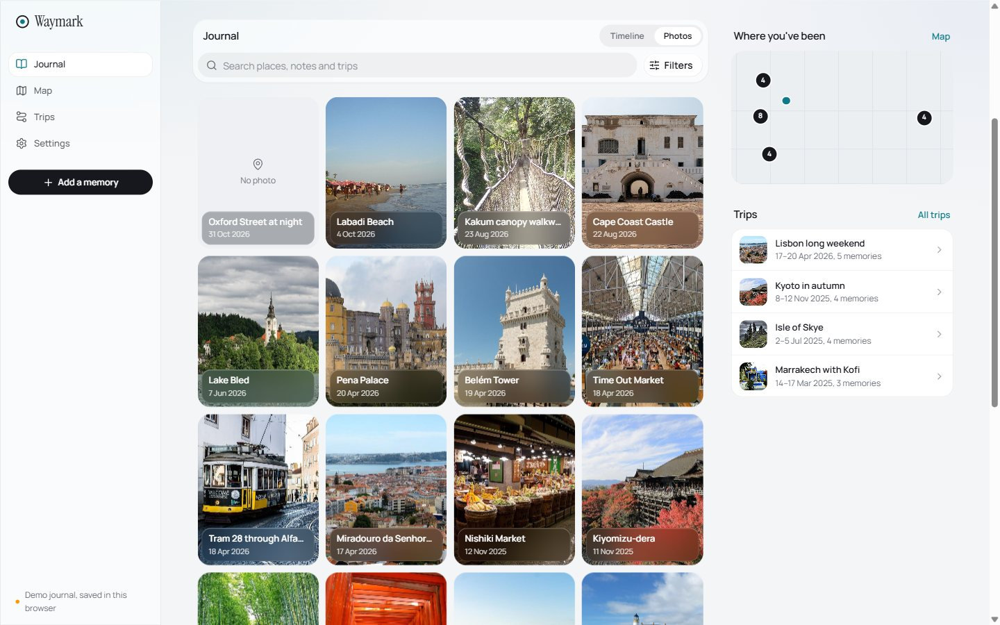
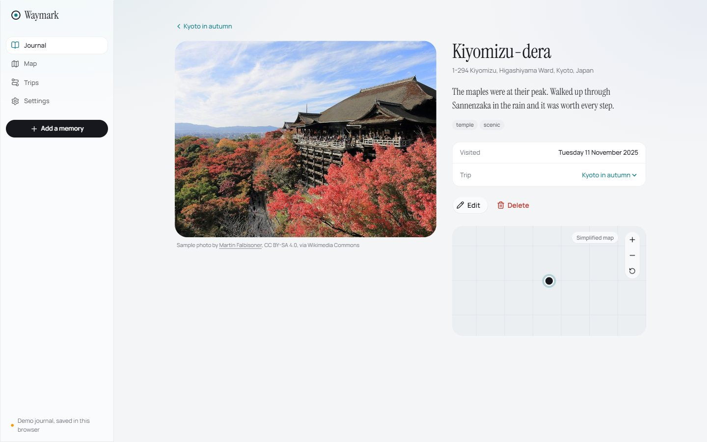
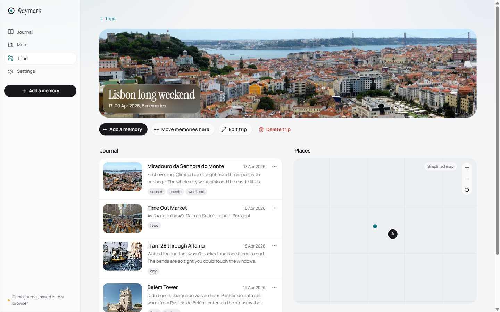
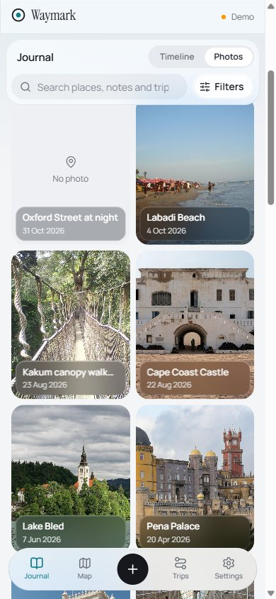
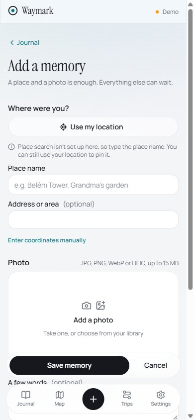
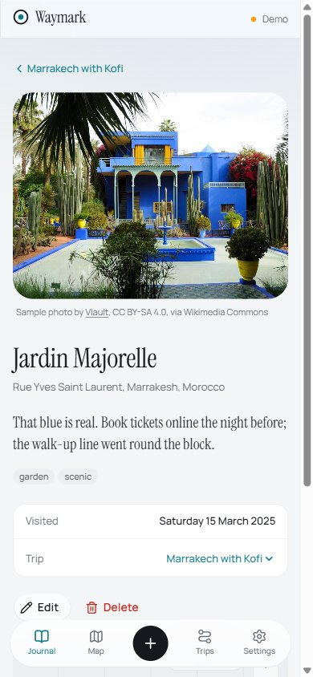
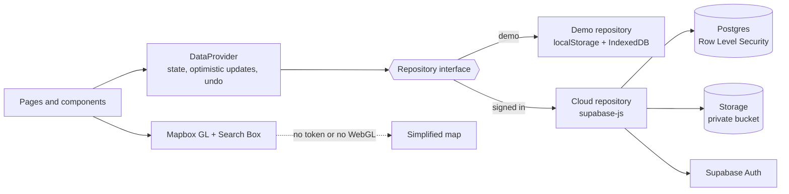

<div align="center">


# Waymark

**A private, visual journal for the places you've been.**

Save a place in seconds with just a name and a photo, then find it again in your journal, on your own map, or inside a trip.

[](https://nextjs.org)
[](https://react.dev)
[](https://www.typescriptlang.org)
[](https://tailwindcss.com)
[](https://supabase.com)
[](https://www.mapbox.com)
[](#testing)

[Features](#features) · [Quick start](#quick-start) · [Architecture](#architecture) · [Security](#data-model-and-security) · [Testing](#testing) · [Deployment](#deployment)

</div>

<br />



## Overview

Waymark is a travel journal, not a social network or a trip planner. There are no public profiles, followers, likes or feeds: every memory is private to the person who saved it.

The product is built around one fast action, **Add a memory**. A place and a photo is a complete entry; notes, dates, tags and trips can be added later. Everything else exists to help you find that memory again.

The app runs in two modes behind one interface:

- **Demo mode** works with no configuration. It loads a realistic sample journal and keeps all changes in the browser.
- **Cloud mode** stores each person's journal in Supabase, protected by Row Level Security and private photo storage.

## Features

**Capture**
- Quick add with place search (Mapbox), current location on request, or manual entry
- Photo upload with real progress, automatic resizing and removal of embedded GPS data
- Optional note, visit date (defaults to today), tags and trip, all editable later
- Inline validation; a failed upload keeps the form and offers to retry or save without the photo

**Revisit**
- Journal as a timeline grouped by trip or month, or as a photo grid
- Search across places, notes, addresses and trip names, with date-range and tag filters kept in the URL
- Map with clustered pins and a preview card for each memory
- Memory pages with the photo, note, details and location

**Organise**
- Trips with a name, date range, cover photo and memory count
- Automatic trip suggestions for memories close together in time (3 days) and place (250 km)
- Move memories between trips, singly or in bulk

**Privacy and control**
- Private by default, with owner-only access enforced in the database
- Optional approximate locations that round saved pins to about 1 km
- Location is read once, only when requested, after an explanation
- JSON export of all data, and self-service account deletion
- Deletes can be undone for a few seconds

**Experience**
- Minimal "liquid glass" interface: translucent materials instead of drop shadows, with a single accent colour
- Floating tab bar with Add a memory within thumb reach on phones; sidebar layout on desktop
- Keyboard and screen reader friendly; respects reduced motion and reduced transparency
- Works without a Mapbox token, using manual entry and a simplified accessible map

## Screenshots

<table>
  <tr>
    <td width="50%"><p align="center"><sub>Journal home</sub></p></td>
    <td width="50%"><p align="center"><sub>Photo grid</sub></p></td>
  </tr>
  <tr>
    <td width="50%"><p align="center"><sub>Memory</sub></p></td>
    <td width="50%"><p align="center"><sub>Trip</sub></p></td>
  </tr>
</table>

<table>
  <tr>
    <td width="33%"></td>
    <td width="33%"></td>
    <td width="33%"></td>
  </tr>
  <tr>
    <td align="center"><sub>Journal on a phone</sub></td>
    <td align="center"><sub>Add a memory</sub></td>
    <td align="center"><sub>Memory on a phone</sub></td>
  </tr>
</table>

## Tech stack

| Area | Choice |
| --- | --- |
| Framework | [Next.js 16](https://nextjs.org) App Router with Cache Components, React 19, TypeScript (strict) |
| UI | [Tailwind CSS 4](https://tailwindcss.com), [shadcn/ui](https://ui.shadcn.com) on Base UI, Lucide icons |
| Typography | Manrope for the interface, Instrument Serif for titles and journal notes |
| Data, auth and files | [Supabase](https://supabase.com): Postgres with Row Level Security, Auth, Storage |
| Maps and places | [Mapbox GL JS](https://docs.mapbox.com/mapbox-gl-js/) and the Search Box API |
| Forms | React Hook Form with Zod schemas |
| Testing | Vitest (unit and database), Playwright (end to end) |
| Hosting | Vercel |

## Quick start

**Requirements:** Node.js 20.9 or later (developed on Node 24) and npm.

```bash
git clone https://github.com/ohenemanaf/waymark.git
cd waymark
npm install
npm run dev
```

Open http://localhost:3000 and choose **Explore the demo**. No accounts or keys are needed.

To enable accounts and real maps, copy the example environment file and fill in the values described below:

```bash
cp .env.example .env.local
```

## Configuration

All variables are public, browser-safe values. Each one is optional, and the app degrades gracefully without it.

| Variable | Enables | Without it |
| --- | --- | --- |
| `NEXT_PUBLIC_SUPABASE_URL` | Accounts and cloud storage | Sign-in is turned off and the demo is used |
| `NEXT_PUBLIC_SUPABASE_ANON_KEY` or `NEXT_PUBLIC_SUPABASE_PUBLISHABLE_KEY` | Accounts and cloud storage | As above |
| `NEXT_PUBLIC_MAPBOX_TOKEN` | Interactive map and place search | Manual place entry and a simplified, keyboard-accessible map |

> [!IMPORTANT]
> Waymark never uses the Supabase service-role key. Do not add it to the app or to Vercel. Account deletion runs through a database function that can only delete the signed-in caller.

### Supabase

**Hosted project**

1. Create a project at [supabase.com](https://supabase.com).
2. Apply the schema: link the CLI with `npx supabase link` and run `npx supabase db push`, or paste [`supabase/migrations/20261115000000_init.sql`](supabase/migrations/20261115000000_init.sql) into the SQL editor.
3. In **Auth → URL configuration**, set the Site URL to your deployment and add `https://<your-domain>/journal` and `http://localhost:3000/journal` as redirect URLs, so confirmation emails return to the app.
4. Add the project URL and anon (or publishable) key to `.env.local` and to your hosting environment.

**Local stack (Docker)**

```bash
npx supabase start
```

This starts Postgres, Auth, the REST API and Storage, and applies the migration. Put the printed API URL and anon key in `.env.local`. Email confirmation is off locally, so new accounts can sign in immediately. Stop the stack with `npx supabase stop`.

### Mapbox

Create a public token at [account.mapbox.com](https://account.mapbox.com) and restrict it to your domains. Waymark uses the `light-v11` style with clustered pins, the Search Box API `/forward` endpoint for place search, and `/reverse` for **Use my location**. If the token is missing or the map can't load (for example, when WebGL is unavailable), the simplified map is used automatically.

## Demo mode

The demo is the journal of Ama, a traveller based in Accra: 21 memories over two years across four trips (Marrakech, Isle of Skye, Kyoto and Lisbon), plus memories from home and a work trip to Slovenia. It is designed to show every state:

- Two Ghana memories are left out of a trip, so a **trip suggestion** appears.
- One memory has **no photo**, and some have **no note**.

| Data | Stored in |
| --- | --- |
| Memories, trips and profile | `localStorage` (`waymark:demo:v2`) |
| Photos you add | IndexedDB (`waymark-demo`) |
| Sample photos | Bundled in [`public/demo`](public/demo), so the demo works offline |

A badge in the navigation always shows whether you are in the demo or your private cloud journal. **Settings → Reset sample data** restores the original journal.

## Architecture



- **One interface, two backends.** Screens talk only to [`DataProvider`](src/components/providers/data-provider.tsx), which delegates to a [`Repository`](src/lib/data/repository.ts). The demo and cloud implementations are interchangeable, so every screen works the same in both modes.
- **Session gate.** [`SessionProvider`](src/components/providers/session-provider.tsx) decides between demo, signed-in and signed-out, and [`AppGate`](src/components/app-gate.tsx) protects the app routes.
- **Optimistic, recoverable writes.** Changes appear immediately. Deletes wait six seconds behind an **Undo** action before they are committed.
- **Photos.** Files are resized and re-encoded in the browser, uploaded with progress to `<user id>/<uuid>.jpg`, and displayed through signed URLs that expire after an hour.
- **Validation in two places.** Zod schemas give inline feedback in forms, and database constraints enforce the same rules on the server.

## Data model and security

| Table | Columns |
| --- | --- |
| `profiles` | `id` (the auth user), `display_name`, `approximate_location`, `created_at` |
| `trips` | `id`, `user_id`, `name`, `start_date`, `end_date`, `cover_photo_path`, `created_at` |
| `memories` | `id`, `user_id`, `trip_id` (optional), `place_name`, `address`, `latitude`, `longitude`, `visited_on`, `note`, `photo_path`, `tags`, `created_at`, `updated_at` |

Indexes cover `(user_id, visited_on desc)`, `trip_id`, `(user_id, lower(place_name))`, `(user_id, start_date desc)` and tags (GIN). Deleting a trip keeps its memories. Deleting a user removes everything they own.

**Row Level Security** is enabled on every table, and every policy is limited to signed-in users:

| Table | Read | Create | Update | Delete |
| --- | --- | --- | --- | --- |
| `profiles` | own row | own row | own row | via account deletion |
| `trips` | own rows | own rows | own rows | own rows |
| `memories` | own rows | own rows, and only into the person's own trips | same as create | own rows |
| Photos (`memory-photos` bucket) | own folder | own folder | own folder | own folder |

The photo bucket is private, accepts images only, and limits files to 15 MB. The database also rejects invalid values, such as an empty place name, out-of-range or unpaired coordinates, more than 10 tags, or a trip that ends before it starts.

`delete_account()` removes only the caller's auth user, and the cascade deletes their profile, trips and memories. The app deletes the person's photo files first.

## Testing

| Command | Covers | Requires |
| --- | --- | --- |
| `npm test` | Search and filters, trip suggestions, validation, geographic and date helpers, and consistency of the demo data | Nothing |
| `npm run test:db` | The real schema: data isolation between two users, writes into other people's trips, photo folder access, database constraints, cascade on trip deletion and account deletion | A local Supabase stack (skipped otherwise) |
| `npm run test:e2e` | Demo browsing, adding and editing with a photo, search, delete with undo, trip suggestions, moving memories, map preview, the phone layout, and the full signed-in flow with upload, export and account deletion | `npm run build` first; the signed-in test also needs the build pointed at local Supabase and `NEXT_PUBLIC_SUPABASE_URL` set |

The database tests are checked against a deliberately weakened schema: with Row Level Security turned off, the isolation tests fail as expected.

| Script | Purpose |
| --- | --- |
| `npm run dev` | Start the development server |
| `npm run build` / `npm start` | Production build and server |
| `npm run lint` | ESLint |
| `npm run typecheck` | TypeScript, no emit |

## Deployment

Waymark is built for [Vercel](https://vercel.com):

1. Import the repository. The Next.js preset is detected automatically.
2. Add the environment variables from [Configuration](#configuration) for Production and Preview.
3. Deploy, then add the production URL to the Supabase auth redirect URLs.

## Project structure

```text
src/
├── app/
│   ├── page.tsx                  Landing page
│   ├── auth/                     Sign in and sign up
│   ├── (app)/                    Demo or signed-in area, behind AppGate
│   │   ├── journal/              Home: greeting, recent, timeline or grid, filters, map and trips
│   │   ├── map/                  Full-screen map with a floating list of places
│   │   ├── trips/                Trips, suggestions and trip detail
│   │   ├── memories/             Add, view and edit a memory
│   │   └── settings/             Profile, privacy, export and account deletion
│   ├── not-found.tsx, error.tsx  Not-found and error screens
│   └── globals.css               Design tokens and glass materials
├── components/
│   ├── providers/                Session and data providers
│   ├── map/                      Mapbox map, simplified map, preview card
│   ├── memory-form/              Quick-add form, place search, location, photo, tags
│   └── ui/                       Base UI primitives
└── lib/
    ├── data/                     Repository interface, demo and cloud implementations, sample data
    ├── schema.ts                 Zod schemas
    └── trips.ts                  Trip suggestions, date ranges and covers
supabase/
├── migrations/                   Schema, Row Level Security and storage policies
└── config.toml                   Local stack configuration
tests/
├── unit/                         Vitest unit tests
├── db/                           Database tests against local Supabase
└── e2e/                          Playwright end-to-end tests
docs/screenshots/                 Images used in this README
```

## Accessibility

- Skip link, semantic headings, labelled landmarks and visible focus states throughout
- Form fields have labels and linked error messages; errors use text and an icon, never colour alone
- Place search is an ARIA combobox with arrow-key navigation and announced result counts
- Saves, deletes and filter results are announced through toasts and live regions
- The map always has a list of places alongside it, so every pin is reachable without a pointer
- Reduced-motion and reduced-transparency preferences are respected

## Credits

- Sample photos are from [Wikimedia Commons](https://commons.wikimedia.org) under Creative Commons licences or in the public domain. Each photo's author, licence and source are listed in [`src/lib/data/seed.ts`](src/lib/data/seed.ts) and shown under the photo in the app.
- Typefaces: [Manrope](https://fonts.google.com/specimen/Manrope) and [Instrument Serif](https://fonts.google.com/specimen/Instrument+Serif), via Google Fonts.
- Icons: [Lucide](https://lucide.dev).

## License

No open-source licence has been chosen yet, so all rights are reserved by the author. Sample photos remain under their own licences.
